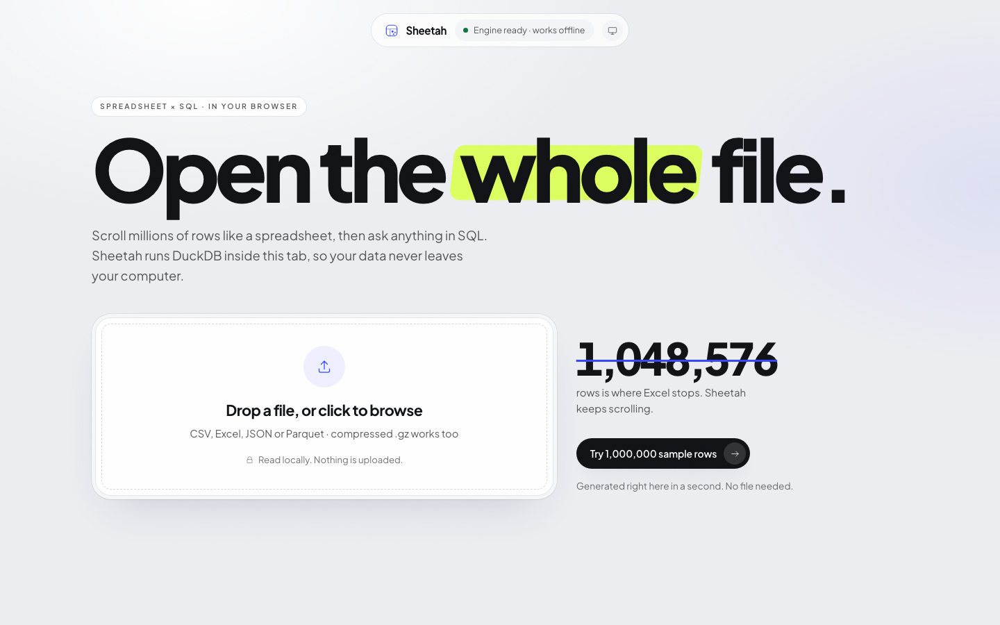
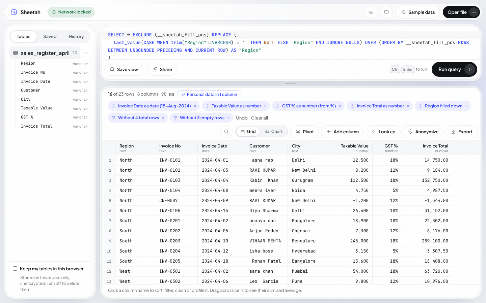
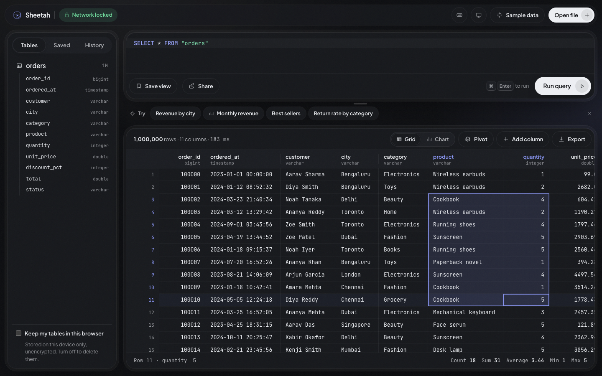
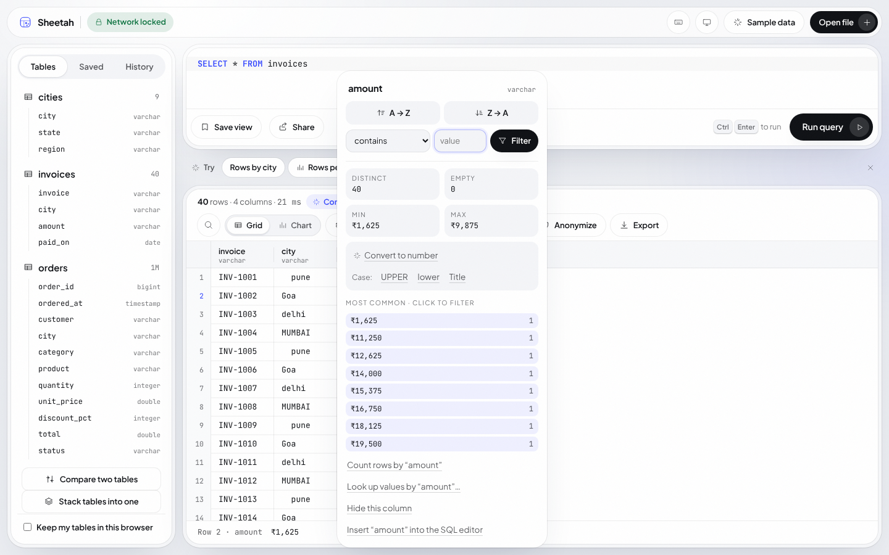
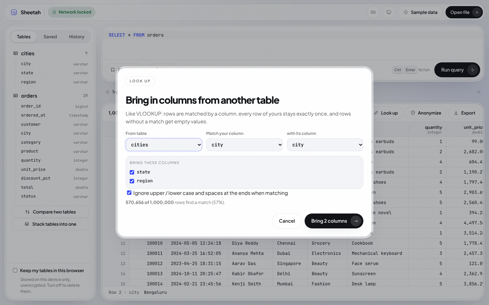
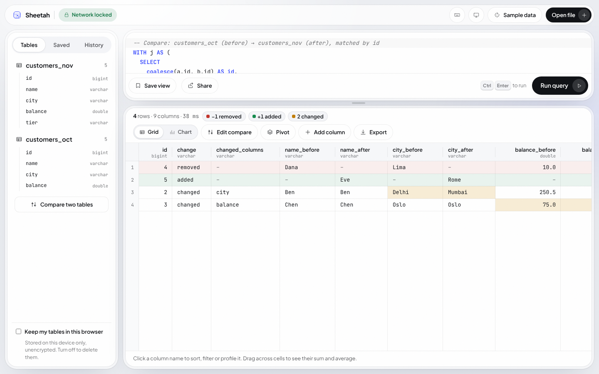
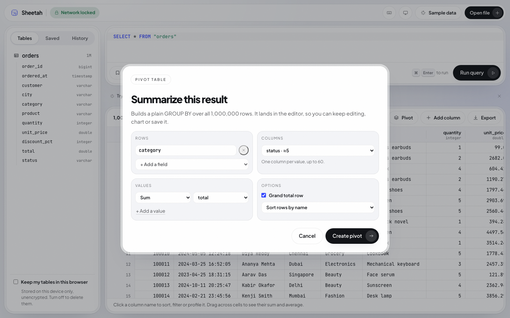
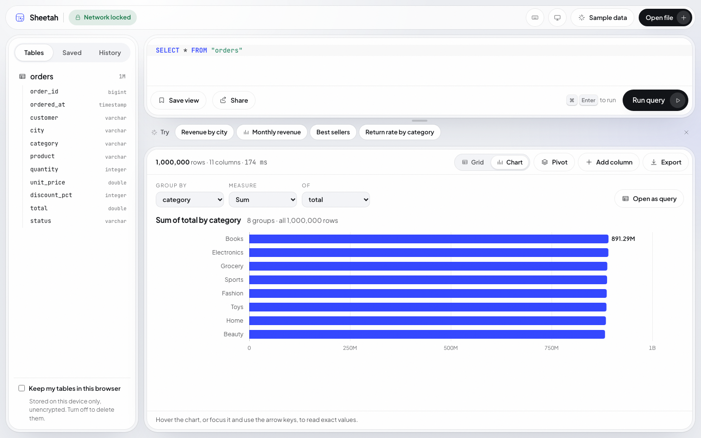
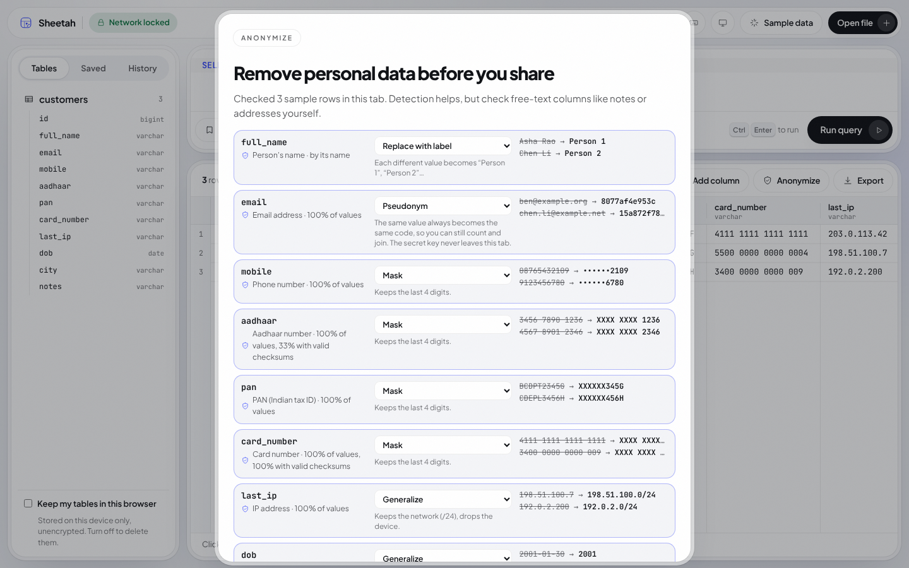
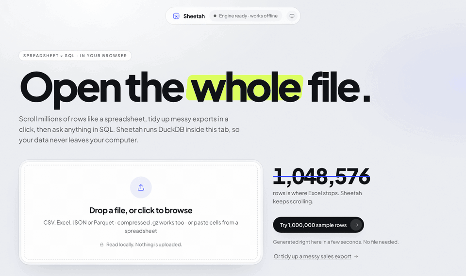

# Sheetah

**Open the whole file.** A spreadsheet that scrolls millions of rows and speaks SQL, running entirely in your browser.
Sheetah ships DuckDB (compiled to WebAssembly) with the page, so files are read from your disk and never uploaded.
There is no backend; it deploys as a static site for free.

**Live:** [sheetah.vercel.app](https://sheetah.vercel.app) · MIT licensed · works in current Chrome, Edge, Firefox and Safari



| | |
|---|---|
|  |  |
|  |  |
|  |  |
|  |  |

### Open anything, all of it

- **Canvas grid** that stays at ~60 fps from 1 to 10,000,000+ rows; the first column stays in view while wide tables scroll
- **Open** CSV, TSV, Excel (.xlsx, every sheet becomes a table), JSON / NDJSON, Parquet, and gzipped CSV; drop several files at once and join them
- **Paste cells** copied from Excel, Google Sheets or the grid itself (⌘/Ctrl + V) and they become a table
- **The ".xls" that isn't**: a web page's table or Excel 2003 XML (what banks and ERPs export) opens like a workbook, and Excel's UTF-16 "Unicode text" too; a PDF, an image or a zip renamed .csv says what it is instead of failing
- **Spreadsheet-grade numbers**: thousands separators in your locale, decimals that match the data, percentages as 18%, exact 64-bit values; column widths survive sorting and filtering
- **Status bar**: select any range for count / sum / average / min / max, computed by SQL so it works on a million rows
- **1,000,000-row sample** generated inside the engine, with one-click starter queries; and a small **messy sales export** to try the clean-up on

### Tidy a messy export

- **Suggestions when a file opens**: total lines and empty rows to leave out (so sums aren't doubled, with a tie-out that names a column that's short, and by how much), group names written once per group to fill down, numbers and dates stored as text to convert (their headers say so), names with stray spaces, empty columns, dates the reader may have read the wrong way round, months laid out as columns to turn into rows, the row the column names are really on, personal data to anonymize
- **Categories from words**: narrations (or any text) grouped by rules like *swiggy, zomato → Food*, picked from the column's common words, then pivoted by month; kept with a saved view
- **Bank statements**: money in and out by month, a signed amount from Deposit and Withdrawal columns, a check that every running balance follows from the row before, opening and closing balance lines left out with the total line, and two-digit years (01/04/24) read day first
- **Clean a column**: ₹1,200 · 1,00,000 · (250) · 12% · 50,000.00 Cr · 15/08/24 to real numbers and dates, extra spaces, case, fill down, replace a value; codes with leading zeros and phone numbers are never converted
- **Point-and-click** sort, filter (type-aware: between, at least, doesn't contain, pick values), find in every column (⌘/Ctrl + F), duplicates, hide, formula columns, date parts and split, column profiles; each step is a chip, every one composes readable SQL (and never silently replaces SQL you edited but didn't run), and **undo / redo** (⌘/Ctrl + Z) covers them all
- **Look up** values from another table (VLOOKUP without the formula), **stack** monthly exports into one, **unpivot** month columns, **compare** two versions of a file, **match payments** bank against books (same amount, dates a few days apart); each offered when the files you open call for it
- **Your SQL on the tidied rows**: a query typed against the file is offered the tidy-up steps as a `WITH`, so clicks and SQL work together
- **Saved views** re-run next month, steps and all (as chips), and check the new file again (running balance, totals against rows): a file with the same columns under a new name is recognised and offered the view; export views to a file to hand to a colleague (only names, SQL and the steps behind it travel, never data, and imported views are shown before they run)

### Answer questions

- **SQL editor** with highlighting and table/column autocomplete (⌘/Ctrl + Enter), cancellable, with errors explained in spreadsheet terms (text in double quotes, a misspelt table with your tables listed, VLOOKUP or SUMIF and what does the job in SQL, clauses out of order) and DuckDB's own message under Details
- **Pivot tables**: rows, columns (dates by year, quarter, month, week or day), up to three values, totals, as readable SQL
- **Quick charts**: trend over time (by day, week, month, quarter or year), top groups, or a distribution, computed over every row; "Open as query" turns a chart back into a table
- **Example queries for any table**: totals by a category, a monthly trend, the largest rows, a summary of every column

### Share it, privately

- **Export** to Excel (.xlsx with real numbers, dates and percentages, a frozen header and filters; text never becomes a formula; a pivot with the rows behind it on a second sheet), CSV (Excel-safe or exact values) or Parquet, with descriptive file names
- **Anonymize before sharing**: emails, phone numbers, Aadhaar (checksum-verified), PAN, card numbers (Luhn), IP addresses, names and birth dates, masked, pseudonymized (keyed, so joins still work), generalized or removed, with previews
- **Share a query as a link**: only the SQL travels, inside the URL fragment, so not even the host sees it; links never auto-run
- **Works offline** after the first visit, installs as an app and opens files from your OS, and new versions are offered, never forced mid-session; **keep my tables** (optional) brings them back after a reload; nothing is uploaded, ever
- **Light, dark or system theme**; a **phone layout** with the library in a bottom sheet and the SQL folded to one line

## The monthly export, in four clicks



The job Sheetah is shaped around: the same report lands every month (from Tally, an ERP, a bank portal), and it
needs the same tidying before it can be summed.

1. **Open it** (or try *Or tidy up a messy sales export* on the landing page). Sheetah notices what's wrong: total
   lines and empty rows, amounts and dates stored as text, a region named once per group, months laid out as columns.
2. **Click the suggestions**: *Leave out 4 total lines and 3 empty rows*, *Convert 4 text columns to numbers and
   dates*, *Fill down Region*. Every step is a chip you can remove, and Undo works.
3. **Save view.** The steps are plain SQL (`WHERE NOT is_grand_or_subtotal("Region")`, `number_from_text("Taxable
   Value")`, `date_from_text("Invoice Date", '%d-%b-%Y')`), saved in this browser with the columns they expect.
4. **Next month, open the new file.** Sheetah recognises it by its columns, whatever it's called, and offers to run
   the view on it: *Your view "Tidy sales register" fits sales_register_may. Run it.* Then export to Excel.

## Run it

Node 22 (see `.nvmrc`).

```bash
npm ci
npm run dev        # http://localhost:5173
npm run build      # static site in dist/
```

Tests (see [CONTRIBUTING.md](CONTRIBUTING.md)):

```bash
npx playwright install chromium   # once
npm run test:unit                 # pure functions, seconds, no browser
npm test                          # build, then unit + end-to-end + perf against the production build
```

`npm run build` first runs `scripts/fetch-duckdb-extensions.mjs`, which downloads the Parquet and JSON extensions for the
bundled DuckDB version into `public/duckdb-extensions/`, so the site serves them itself, and checks each file against the
SHA-256 pinned in `scripts/duckdb-extensions.lock.json`. The app never loads code from another host. If the extensions are
missing (e.g. `npm run dev` without a build), Parquet/JSON show a clear message; CSV and Excel always work.

## Deploy (free)

1. The extension hashes are pinned in `scripts/duckdb-extensions.lock.json` (committed). Builds on CI and Vercel fail if
   a downloaded extension doesn't match.
2. **Vercel:** import the repo. `vercel.json` sets the framework, `npm ci --ignore-scripts` as the install (the same
   locked tree CI tests, without install scripts), the security headers (CSP and friends) and caching.
3. If the site lives somewhere other than `https://sheetah.vercel.app`, set `VITE_SITE_URL` (see `.env`): it feeds the
   canonical link and the social-preview tags. `public/robots.txt` and `public/sitemap.xml` name the URL too.
4. Check the headers on the live site: `curl -sI https://sheetah.vercel.app | grep -i content-security`.

Each deploy stamps its content hash into the service worker, so returning visitors get "A new version of Sheetah is
ready · Reload" instead of a stale offline copy; unchanged engine files are reused, not downloaded again.

The DuckDB engine is a ~36 MB `.wasm` file (~8 MB compressed over the wire). Vercel and Netlify serve it fine.
Cloudflare Pages caps single files at 25 MiB, so it isn't a good fit without splitting tricks.

## How it works

```
                 ┌───────────── main thread ─────────────┐        ┌──────── Web Worker ────────┐
 your file ───▶  │ registerFileHandle (read in place)    │ ─────▶ │ DuckDB-WASM (sealed)        │
                 │                                       │        │                             │
 your SQL  ───▶  │ runConn: user queries & loads, one    │ ─────▶ │ CREATE TABLE __sheetah.     │
                 │ at a time, send() so Cancel works     │        │   result_N AS (your SQL)    │
                 │                                       │        │                             │
 canvas grid ◀── │ conn: 200-row windows by rowid, stats,│ ◀───── │ SELECT … WHERE rowid        │
                 │ profiles, charts, pivots, metadata    │        │   BETWEEN a AND b           │
                 └───────────────────────────────────────┘        └─────────────────────────────┘
```

- **Two connections, one job each.** DuckDB-WASM abandons a connection's running `send()` if another query arrives on
  that same connection. User queries and file loads therefore get their own connection, serialised by a lock and
  cancellable; everything the UI reads (grid windows, stats, profiles, background snapshots) uses the other, so
  scrolling never kills a running query. Results live in a hidden `__sheetah` schema both connections can see.

```
File ──registerFileHandle──▶ DuckDB-WASM (Web Worker)
                                  │  CREATE TABLE t AS SELECT * FROM read_csv_auto(file)
your SQL ──────────────────────▶  CREATE TEMP TABLE __result AS SELECT * FROM (your SQL)
                                  │
Canvas grid ◀── 200-row chunks ── SELECT cols::VARCHAR FROM __result WHERE rowid BETWEEN a AND b
```

- **Windowed fetch by `rowid`, not `OFFSET`.** Every result is materialised once into a temp table; the grid then asks for
  any 200-row window by `rowid` range, which DuckDB answers from zone maps in milliseconds at any depth.
  `OFFSET 9,000,000` would scan nine million rows.
- **One canvas, no DOM per cell.** Each frame draws only the visible cells (one clip region per column, monospace
  truncation without measuring every string). A small LRU keeps ~60k rows warm; missing chunks render as skeleton bars
  and fill in as they arrive.
- **Beating the browser's height limit.** Elements can't be taller than ~33M px, and 10M rows × 30 px is 300M px. Past
  8M px the scrollbar maps proportionally onto row space, keeping sub-row offsets so scrolling stays smooth.
- **Excel off the main thread.** `.xlsx` is parsed in a Web Worker (`read-excel-file`), each sheet is handed to DuckDB as
  CSV text, and DuckDB's sniffer recovers dates, booleans and numbers. The page stays responsive while a big workbook loads.
- **Views survive file renames.** A saved view records which tables it reads. When those tables aren't open, a small
  SQL tokenizer (`src/engine/views.ts`) swaps the identifiers, skipping strings, comments and `alias.column` references,
  after suggesting the closest match (`sales_oct` → `sales_nov`).
- **UI actions are SQL.** Sorting, filters and formula columns are an `Ops` object composed around your last query
  (`src/engine/compose.ts`). The composed SQL appears in the editor, so the UI teaches SQL instead of hiding it.
- **Pivots without PIVOT.** A pivot compiles to one conditional aggregate per column value
  (`sum(x) FILTER (WHERE status = 'shipped')`) plus a Total column, with the grand-total row from `GROUPING SETS`.
  That keeps row and column totals consistent, handles NULL groups, and reads like SQL a person would write. Column
  fields are capped at 60 values with a message that says what to do instead.
- **Charts are one GROUP BY.** The chart view never samples: a time axis is bucketed (`date_trunc` by hour, day, week
  or month depending on the span), categories are ranked and cut to the top 20, numbers get a 20-bin histogram. Each
  chart carries its own standalone SQL, which "Open as query" runs as the table view.
- **Snapshots as Arrow.** "Keep my tables" writes each table as an Arrow IPC stream into the Origin Private File System
  and reloads it with `insertArrowFromIPCStream`, so types (BIGINT, DECIMAL, dates, lists) round-trip exactly.
- **Range math in SQL.** The status bar's sum/average for a selected block runs `SELECT sum(x) … WHERE rowid BETWEEN`,
  so selecting 500,000 cells costs one query, not a JavaScript loop.

## Measured (headless Chromium, 1440×900)

| Scenario | Result |
|---|---|
| Engine start | ~1.6 s |
| Generate 1M-row sample | ~0.6 s |
| Open a 63 MB, 2,000,000-row CSV | ~1.3 s |
| Full-range scroll, 1M rows | 16.6 ms median frame (60 fps), p95 ≈ 24 ms |
| Random jumps, 10M rows | 16.7 ms median frame |
| Export 2M rows to CSV | 61 MB file, a few seconds |
| Import a 100,000-row .xlsx (2.9 MB) | ~2.4 s, types preserved |
| JavaScript before first paint | 186 KB gzip, everything `index.html` loads and preloads (CI budget 190 KB); the engine (WASM), the editor, dialogs, the column menu, charts, error explanations and file sniffing load after |

## Testing

- **Unit** (`tests/unit`, Node, no browser): the SQL the app generates is executed on the same DuckDB-WASM build,
  in Node (`tests/unit/duck.ts`), and its rows checked: filters, find, duplicates, hidden columns, compare, clean,
  look-up, stack, anonymize, starter queries. Plus statement splitting, number parsing and formatting, share-link
  encoding (including a decompression bomb), checksums, and the Excel writer (read back with an independent reader).
- **End to end** (`tests/*.spec.ts`, Playwright + Chromium) against the production build served with the real
  security headers: grid and engine, robustness (concurrency, `rowid` columns, name clashes, odd files), files and
  exports (including Excel), saved views, pivots, charts, compare, anonymize, clean-up, look-up, stack, undo, kept
  tables, share links, offline and multi-tab updates, SEO and
  the unsupported-browser screen, 13 exfiltration attacks, and axe-core audits of every screen and dialog in both
  themes.
- **Perf** (`@perf`, one worker): 1M-row scroll frame times.
- CI also runs `npm audit`, lint, a bundle-size budget (`scripts/check-bundle-size.mjs`) and the extension lock check.

## Project layout

```
src/
  engine/db.ts          DuckDB-WASM bootstrap, sealing, the two connections, run lock, cancellation, pseudonym key
  engine/sql.ts         pure SQL text helpers: quoting, statement splitting, table names (unit-tested)
  engine/ingest.ts      file → table (cancellable, never overwrites), 1M-row sample, table metadata
  engine/result.ts      run SQL → windowed ResultSet, range stats, column profile, top values, export
  engine/xlsx-write.ts  streaming, dependency-free .xlsx writer (typed cells, zip via CompressionStream)
  engine/clean.ts       clean a column: numbers/dates stored as text, spaces, case, replace; total and empty rows
  engine/messy.ts       the messy sample export (built in the page, opened like a dropped file)
  engine/lookup.ts      look up columns from another table (a LEFT JOIN that can't add rows)
  engine/stack.ts       stack tables by column name (UNION ALL BY NAME, type conflicts as text)
  engine/unpivot.ts     month/quarter/year column series → UNPIVOT SQL (unit-tested)
  engine/sheet-csv.ts   Excel sheet → CSV for DuckDB, skipping report title lines (unit-tested)
  engine/compose.ts     sort / filter / formula columns → readable SQL (unit-tested)
  engine/views.ts       saved views: storage, table detection, table-only renaming, next month's file (unit-tested)
  engine/pivot.ts       pivot specs → GROUP BY / FILTER / GROUPING SETS SQL
  engine/chart.ts       chart specs → aggregate SQL (buckets, top-N, histograms)
  engine/compare.ts     compare two tables: key suggestions, key health, FULL JOIN / EXCEPT ALL SQL
  engine/pii-rules.ts   personal-data patterns, checksums and anonymize SQL (unit-tested)
  engine/pii.ts         personal-data detection on a sample, previews
  engine/share.ts       share links: SQL ⇄ compressed URL fragment, bomb-proof decoding
  engine/persist.ts     "keep my tables": Arrow snapshots in OPFS
  engine/xlsx.worker.ts Excel parsing in a Web Worker
  grid/Grid.tsx         canvas grid: virtual scroll, chunk cache, selection, keyboard, copy, diff tints
  grid/format.ts        display formatting for numbers and dates (unit-tested)
  components/           landing, SQL editor (CodeMirror 6), column menu, dialogs, Chart (SVG), error boundary;
                        Library (tables / saved / history), StepChips and HintChips (applied steps, suggestions), Toasts
  App.tsx               the workspace: runs queries, composes header actions, undo/redo, hints, file loading
  sw-client.ts          service-worker registration and the "new version" prompt
public/
  sw.js                 offline service worker (versioned per build by vite.config.ts)
  compat.js             unsupported-browser check (runs before the app)
  privacy.html, 404.html, robots.txt, sitemap.xml, og.png, icons/
tests/
  unit/                 Node unit tests
  *.spec.ts             end-to-end suite against the production build under the real CSP
docs/
  research.md           desk research synthesis that shaped the product
  ux-copy.md            copy review
  design-critique.md    design review and follow-ups
  accessibility.md      audit and keyboard map
scripts/
  fetch-duckdb-extensions.mjs   self-hosted, hash-pinned DuckDB extensions
  check-bundle-size.mjs         CI budget for the JavaScript a visitor downloads first
```

## Known limits

- Data lives in browser memory: very large CSVs (several GB) can exceed the tab's limit. Parquet stays on disk as a view.
- Legacy `.xls` (pre-2007 binary) isn't supported; re-save as `.xlsx`. Very large workbooks parse slower than CSV.
- Saved views and kept tables live in this browser's storage (no sync across devices). Kept tables are capped at
  5M rows each, and views over Parquet files aren't kept (re-open the file).
- Personal-data detection checks a 5,000-row sample with patterns and checksums; it can miss free text (notes,
  addresses inside other columns). Review the columns before sharing.
- Temporary tables you create in SQL (`CREATE TEMP TABLE`) work in queries but aren't listed in the sidebar.

## Browser support

Current Chrome, Edge, Firefox and Safari (Chrome/Edge 111+, Firefox 114+, Safari 16.4+), desktop and mobile. Sheetah
needs WebAssembly with exception handling; older browsers get a plain explanation instead of a blank page. "Keep my
tables" needs writable OPFS files (Safari 26+). The end-to-end suite runs in Chromium.

## Security

Sheetah treats every query as untrusted: people paste SQL from the internet. Two independent layers keep data in the tab:

1. **Sealed engine.** Before the app can run anything, DuckDB is restricted to a virtual `/sheetah/` folder,
   `enable_external_access` is switched off and the configuration is locked. URL reads, `ATTACH`, `COPY TO` a URL,
   remote extensions and path traversal all fail, and SQL can't undo it.
2. **Content-Security-Policy.** The browser refuses connections to any other origin (`connect-src 'self'`), with no
   inline scripts and no `eval`.

Share links carry only SQL, in the `#fragment` (never sent to a server), and are shown for review instead of running;
imported views show their SQL for review before they first run.
Kept tables are opt-in, stored unencrypted in this site's private browser storage, and wiped by "Clear all local data".

Verified with 13 attack queries run through the editor: all blocked, zero outbound requests. Plus pinned dependencies,
hash-checked extensions, CI audit, Excel-safe CSV export, and optional history. See [SECURITY.md](SECURITY.md) for the
threat model.

## Accessibility

The grid is drawn on a canvas, so Sheetah also renders a visually hidden ARIA grid for the visible window (header row plus
the rows on screen) and points `aria-activedescendant` at the active cell. Screen readers get real rows, columns, headers,
sort state and selection, and range totals are announced through a live region. axe-core reports 0 WCAG 2.1 A/AA
violations on the landing page, workspace, column menu, chart view, and the pivot, compare, anonymize and shortcut
dialogs, in both themes. The full audit and keyboard map are in [docs/accessibility.md](docs/accessibility.md).

## Keyboard

| Keys | Action |
|---|---|
| ⌘/Ctrl + Enter | Run query |
| Arrows, Page Up/Down, Home/End | Move |
| Shift + move / click | Extend selection |
| ⌘/Ctrl + arrows | Jump to edge |
| ⌘/Ctrl + A / C | Select all / copy as TSV |
| ⌘/Ctrl + F | Find text in every column of the result |
| ⌘/Ctrl + Z, ⌘/Ctrl + Shift + Z | Undo / redo a sort, filter, clean-up, look-up or hidden column |
| Alt + ↓ (or Shift + F10) | Open the column menu: sort, filter, profile |
| Tab / Shift + Tab | Move between editor, toolbar and grid (first Tab: skip to grid) |
| Double-click a column edge | Fit width |
| ↑ / ↓ on the editor's resize handle | Shorter / taller (Enter fits the query again) |
| ? | Show all keyboard shortcuts |
